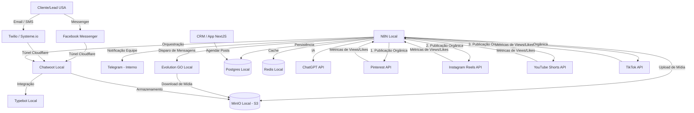

# Regras do Projeto & Guia Operacional — Sistema VitaFlow

Este arquivo centraliza as regras exclusivas, topologia de arquitetura, guias de deploy e roteiro de integrações do **Sistema VitaFlow (CRM & Automações)**.

---

## REGRA ZERO — Método de trabalho (vale antes de qualquer outra seção)

Esta regra existe porque em 08/09/2026 um ajuste responsivo simples consumiu horas e tokens em tentativa-e-erro. A causa não foi dificuldade técnica: foi editar sem ler, declarar pronto sem medir e repetir a mesma tentativa. As seis linhas abaixo são obrigatórias e vêm antes de qualquer outra regra deste arquivo.

1. **Ler antes de editar.** Localizar a causa no código e enunciá-la em até 3 linhas para o Ivan antes de tocar em qualquer arquivo. Proibido editar CSS, JSX ou JS "para ver se resolve".

2. **Invocar as skills antes de planejar** (não depois, não se lembrar):
   - `andrej-karpathy-skills:karpathy-guidelines` — sempre. Mudança cirúrgica, sem overengineering, com critério de sucesso verificável.
   - `superpowers:systematic-debugging` — quando algo está quebrado ou se comporta errado.
   - `frontend-design:frontend-design` ou `anthropic-skills:ui-ux-pro-max` — quando o trabalho é layout, CSS, tipografia ou responsividade.
   - `superpowers:verification-before-completion` — antes de dizer que está pronto.

3. **Um passe por vez.** Uma hipótese, uma correção, um arquivo sempre que possível. Nada de mexer em cinco arquivos na mesma tentativa.

4. **Medir antes de declarar pronto.** Para qualquer mudança visual: abrir no navegador em 375px e 768px e aplicar o critério da seção 3.1, item 6 (zero elementos estourando a viewport fora de container com rolagem). Sem medição feita e mostrada, não se diz "corrigido".

5. **Limite de duas tentativas.** Se a segunda tentativa não resolver, parar. Escrever o diagnóstico do que foi testado, o que foi descartado e qual a hipótese restante, e devolver a decisão para o Ivan. Proibida uma terceira tentativa da mesma natureza.

6. **Nunca repetir uma operação que já falhou** sem antes mudar a hipótese e dizer explicitamente o que mudou. Repetição sem hipótese nova é o que queima o orçamento do Ivan.

> Se em algum momento a resposta a "por que essa tentativa vai dar certo?" for "talvez dê", a regra 5 já foi atingida. Parar e reportar.

---

## 🟢 1. Inicialização do Sistema (Frontend e Backend)
- **Frontend**: Rodar `npm run dev` na pasta `apps/frontend` (Porta/Acesso: `http://localhost:3005`).
- **Backend**: Rodar `npm run dev` na pasta `apps/backend` (Porta/Acesso: `http://localhost:3001`).
- **Verificação Proativa**: Garanta que o frontend e o backend estejam rodando antes de realizar testes de navegação para evitar falhas de comunicação com a API.

---

## 🐳 2. Diretrizes de Infraestrutura (Docker & Portainer)
- **Invariante Crítico de Modificação**: O agente de IA está TERMINANTEMENTE PROIBIDO de iniciar contêineres, reconstruir imagens ou modificar stacks no Docker/Portainer do usuário de forma automática. 
- **Criação Manual**: Todas as novas stacks e contêineres devem ser criados e iniciados exclusivamente de forma manual pelo usuário. A função do agente é apenas gerar e entregar os códigos (Dockerfiles, docker-compose.yml) e as instruções passo a passo.
- **Isolamento de Portas**:
  - PostgreSQL VitaFlow: Porta host `5441` (interno `5432`).
  - Redis VitaFlow: Porta host `6383` (interno `6379`).
  - Backend VitaFlow: Porta host `3001` (interno `3001`).
  - Frontend VitaFlow: Porta host `3005` (interno `3005`).
  - *Nota:* Nunca misture portas ou recursos com o projeto de finanças (Postgres na porta `5442`).

---

## 🎨 3. Identidade Visual, UI & UX Premium
- **Aparência**: Interface escura (Dark Mode sofisticado) com micro-animações, layouts fluidos e visual moderno que impressione o usuário.
- **CRM e Lead Management**: Leads organizados em tabelas e prospectos exibidos em formato Kanban, usando o método de 4Cs de cores.

<RULE[dashboard_fidelity]>
Sempre que o usuário fornecer imagens de referência para a construção de um Dashboard ou tela (ex: Dashboard CVS):
1. O agente DEVE mapear e implementar todas as abas, sub-abas e botões de navegação visíveis na interface. Não abrevie.
2. Nenhuma aba ou seção visual deve ser omitida para poupar tempo. O agente deve garantir que a navegação interna da página cubra 100% das visões mostradas nas referências.
3. O agente deve se atentar a detalhes estruturais (como a barra superior de métricas "Compras Confirmadas / Order Bump" que deve preceder as tabelas de inteligência).
</RULE[dashboard_fidelity]>

<RULE[no_destruction]>
REGRA CRÍTICA DE INTEGRAÇÃO: O agente é TERMINANTEMENTE PROIBIDO de deletar, simplificar, ocultar ou destruir qualquer layout, design, acordeão, botão, aba ou estrutura de frontend pré-existente para implementar qualquer integração de backend (APIs, webhooks, N8N, bancos de dados, etc.). 
Qualquer integração de dados dinâmicos DEVE ser injetada de forma cirúrgica e invisível dentro do design original rico que o usuário já construiu e testou, mantendo fallbacks estáticos para preservar a integridade visual intacta em qualquer circunstância.
</RULE[no_destruction]>

---

## 📱 3.1 Padrao Responsivo (mobile e tablet)

O CRM usa **duas faixas**, sempre nesta ordem, no fim de cada `*.module.css`:

- `@media (max-width: 1024px)` — **tablet**. A sidebar vira gaveta (hamburguer no Header + backdrop) e as colunas laterais descem para baixo do conteudo.
- `@media (max-width: 768px)` — **celular**. Cabecalhos empilham, grades caem para 1 ou 2 colunas e os paddings encolhem.

Regras praticas:
1. **Painel lateral nao existe: e sempre uma coluna so.** O CRM e **unico** — a mesma tela no celular, no tablet e no desktop. Todo bloco que antes ficava ao lado do conteudo agora fica **abaixo** dele em qualquer largura (`grid-template-columns: 1fr` na regra base, sem override de desktop): resumo dos hubs C1-C4, formulario do CRM Leads, formulario do Calendario Editorial, painel de Conteudos, cards de Integracoes, formulario de Ads > Criativos, os dois graficos do Analytics e os funis de Vendas.
   - **Excecao: fileiras de KPI.** Cartoes de indicador continuam em grade (5-6 colunas no desktop, 2-3 no tablet, 1-2 no celular). Eles nao sao painel lateral, e empilhar seis cartoes num monitor de 1440px deixaria a tela vazia.
2. **Tabela nao quebra: rola.** Toda tabela fica dentro de um wrapper com `overflow-x: auto`. Nao esconder colunas.
3. **Fila de abas/filtros nao quebra linha: desliza.** `overflow-x: auto` + `flex: 0 0 auto` nos botoes (ex.: `.pillNav` em vendas, `.headerNav` em newsletter).
4. **Selects e filtros empilham** (`flex: 1 1 100%`) em vez de vazar pela direita.
5. **Modal ganha respiro**: `padding` no overlay e `overflow-y: auto` no conteudo.
6. **Antes de dar por pronto**, medir estouro real no navegador: elemento cujo `getBoundingClientRect().right` passa da largura da viewport e que **nao** esteja dentro de um container com `overflow-x` de rolagem. A meta e zero.

> `body { overflow-x: hidden }` em `globals.css` continua la como rede de seguranca. Ele **esconde** estouro, nao corrige — por isso a medicao do item 6 ignora essa protecao.

> As telas C1, C2, C3 e C4 compartilham **um unico arquivo**: `src/app/c1/page.module.css`. Mexer nele altera as quatro. Os arquivos `c2/`, `c3/` e `c4/page.module.css` existem mas nao sao importados por ninguem.

---

## 🗺️ 4. Topologia de Arquitetura

### Detalhes dos Fluxos
- **n8n**: Responsável por ler agendamentos, fazer uploads de criativos em APIs de anúncios e enviar estatísticas diárias de performance para o banco local.
- **MinIO**: Serve como repositório de criativos (imagens, áudios e vídeos) que as APIs externas precisam ler.
- **Comunicação Site ↔ Sistema**: O Site (Vanilla HTML/CSS/JS na Hostinger) e o Sistema (Docker local) são isolados e se comunicam exclusivamente via requisições de API (Webhooks) expostas pelo Cloudflare Tunnel.

---

## 🔑 5. Configuração Operacional de Credenciais no `.env`

Você precisará configurar as seguintes informações reais no arquivo `.env` da raiz e de `apps/backend/`:
- **Telegram Alert Bot**: Token gerado via `@BotFather` (`TELEGRAM_BOT_TOKEN`) e ID de chat obtido via API getUpdates (`TELEGRAM_CHAT_ID`).
- **Facebook Ads (Meta API)**: Token de acesso do usuário do sistema (`META_ACCESS_TOKEN`) e ID de conta de anúncios (`META_AD_ACCOUNT_ID`).
- **Google Ads**: Token de desenvolvedor (`GOOGLE_ADS_DEVELOPER_TOKEN`), Client ID/Secret OAuth (`GOOGLE_ADS_CLIENT_ID` / `GOOGLE_ADS_CLIENT_SECRET`) e Refresh Token (`GOOGLE_ADS_REFRESH_TOKEN`).
- **Twilio & SendGrid**: Account SID e Auth Token da Twilio (`TWILIO_ACCOUNT_SID` / `TWILIO_AUTH_TOKEN`), número de saída (`TWILIO_FROM_NUMBER`) e chave de API do SendGrid (`SENDGRID_API_KEY`).
- **Systeme.io**: Chave de API pública (`SYSTEMEIO_API_KEY`) para automação de checkout.

---

## 🌐 6. Configuração do Cloudflare Tunnel (cloudflared)

Para expor o servidor local (`localhost:3001` / `localhost:3005`) à internet de forma segura:
1. **Instalação**: `winget install cloudflare.cloudflared` no Windows.
2. **Login**: `cloudflared tunnel login`.
3. **Criação do Túnel**: `cloudflared tunnel create vitaflow-tunnel`.
4. **Mapeamento DNS**: `cloudflared tunnel route dns vitaflow-tunnel api.seudominio.com`.
5. **Execução**:
   - Redirecionar tráfego para a API: `cloudflared tunnel run --url http://localhost:3001 vitaflow-tunnel`
   - Redirecionar tráfego para o Frontend: `cloudflared tunnel run --url http://localhost:3005 vitaflow-tunnel`

---

## 📈 7. Roteiro Sequencial de Integrações (Status do Desenvolvimento)

- **[Passo 1] Banco de Dados Real & Persistência**: ✅ CONCLUÍDO (Prisma migrado e persistência ativa).
- **[Passo 2] Segurança de Webhooks**: ✅ CONCLUÍDO (Validações de assinatura ativas no backend Fastify).
- **[Passo 3] Persistência de Fechamento de Vendas no Kanban**: ✅ CONCLUÍDO (Rota `PUT /api/leads/:id` integrada e persistindo no banco Postgres).
- **[Passo 4] Sincronização Real de Leads via API do Systeme.io**: ✅ CONCLUÍDO (Serviço `SystemeioService` integrado e build testado com sucesso).
- **[Passo 5] Envio de Mensagens Reais via Facebook Messenger Graph API**: ✅ CONCLUÍDO (Implementação real via Fetch na Graph API v19.0).
- **[Passo 6] Bot de Alertas no Telegram para Relatórios de Anúncios de IA**: ✅ CONCLUÍDO (Função `sendAdsReportNotification` integrada ao de Ads).
- **[Passo 7] Recuperação de Vendas via Twilio SendGrid (E-mail) & Twilio SMS**: ✅ CONCLUÍDO (SMS Twilio, E-mail SendGrid e inscrição Systeme.io integrados).
- **[Passo 8] Conexão Real com a Meta Ads API (Facebook Ads)**: ✅ CONCLUÍDO (Consultas à API de insights de campanhas com fallback de segurança).
- **[Passo 9] Conexão Real com a Google Ads API (REST)**: ✅ CONCLUÍDO (Renovação dinâmica de token e consulta de campanhas ativas implementadas).
