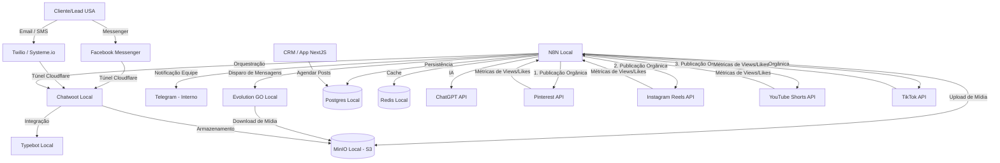

# Arquitetura de Integração — Sistema VitaFlow

Este documento descreve a topologia de rede local, a comunicação entre o site front-end, o back-end (Docker) e as APIs de terceiros para publicidade e tráfego orgânico.

---

## 🗺️ Diagrama Geral da Arquitetura

---

## 🔍 Descrição dos Fluxos e Componentes

### 1. Comunicação Externa (Leads nos EUA)
*   **Twilio & Systeme.io:** Plataformas usadas para envio de campanhas por E-mail e mensagens de texto (SMS).
*   **Facebook Messenger & Chatwoot:** O lead entra em contato via Messenger, a mensagem é encaminhada de forma segura via túnel Cloudflare para o Chatwoot local, onde o Typebot ou o atendente respondem.

### 2. Infraestrutura Central (Docker Back-End)
*   **n8n:** Orquestrador principal responsável por ler agendamentos, fazer uploads de criativos em APIs de anúncios e mídias sociais, e enviar estatísticas diárias de performance para o banco local.
*   **Postgres & Redis:** Persistência dos dados e gerenciamento de filas/cache local.
*   **MinIO (S3 local):** Localizado na máquina local, serve como o repositório de criativos de anúncios e mídias orgânicas (imagens, áudios e vídeos) que as APIs externas precisam ler.

### 3. Automação Orgânica
*   **Agendamento:** O usuário utiliza a interface do CRM (Next.js) para programar as postagens, salvando o arquivo no MinIO e os dados no Postgres.
*   **Disparo:** O n8n puxa os dados do Postgres e da mídia no MinIO e envia para as APIs do Pinterest, Instagram Reels, YouTube Shorts e TikTok.
*   **Métricas:** O n8n busca diariamente as estatísticas das mídias sociais e salva no Postgres para que o CRM as exiba no dashboard de bastidores.
